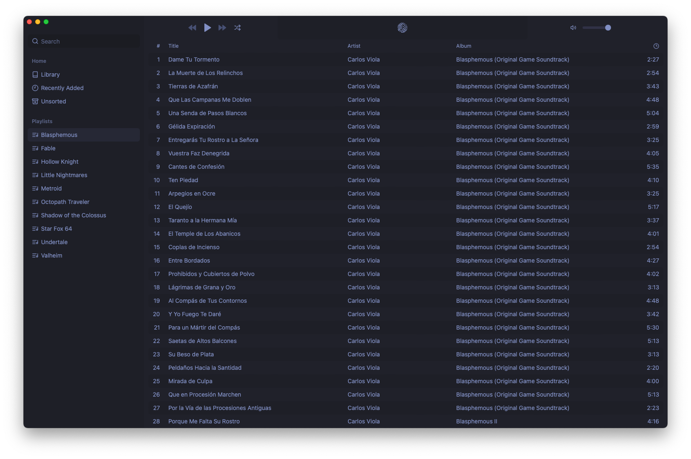
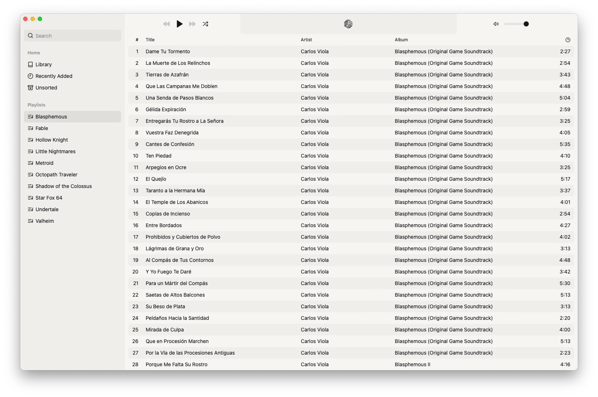

> [!WARNING]
> This project is no longer maintained.

MoonWave was my way of working out from scratch how I want to build apps: which libraries, which tools, and TypeScript after a decade of JavaScript. I also could not find a music player I liked.

What came out of it:

- [Tauri](https://tauri.app) is a good fit for web apps, local-first ones in particular, and Rust is great.
- [Tailwind](https://tailwindcss.com) replaced years of CSS, BEM, Sass and CSS-in-JS, some of it my own.
- Signals replaced the Redux-style state management I had used before.
- Abstractions can be compiled away when building, instead of being paid for when the code runs.
- The dumbest, most minimal code that works, built upon later, beats something that tries to solve everything.

Much of it lives on in [stdlib](https://github.com/MichaelOstermann/stdlib), [signals](https://github.com/MichaelOstermann/signals), [barrels](https://github.com/MichaelOstermann/barrels) and [lsm](https://github.com/MichaelOstermann/lsm). For music I have since moved on to [mpdtui](https://github.com/MichaelOstermann/mpdtui).

<div align="center">


<h1>MoonWave</h1>

**Cross-platform music player for local files.**

</div>





## Installation

See [releases](https://github.com/MichaelOstermann/MoonWave/releases/latest).

## Building

Requirements:

- [Tauri](https://v2.tauri.app/start/prerequisites/#macos)
- [Bun](https://bun.sh/)

```sh
bun install --frozen-lockfile
bun run tauri build
```

Afterwards, the app can be found in `src-tauri/target/*/release/**`.
